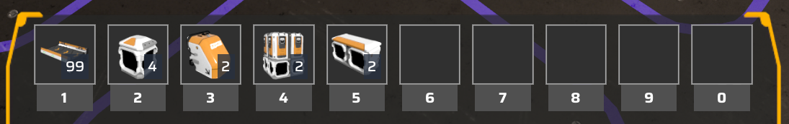

# Elvenide's Build QoL

**Elvenide's Build QoL** is a building quality-of-life mod for **Main Sequence** adding mouse scroll-wheel rotation for machines and conveyors, plus hotbar craftable build counts from your inventory, built with UE4SS Lua.

It is designed to feel native to the base game—matching its exact UI style—and is **100% save-safe and removable** without adding custom items, machines, or save dependencies.

## Getting Started

- **[Getting Started & Installation Guide](docs/get-started.md)**

## Scroll to Rotate Machines & Conveyors

Rotate any station machine, underground belt, or conveyor belt build preview smoothly using the mouse scroll wheel in addition to `R`.

### Usage

- While building **any station machine** (assemblers, refineries, containers, splitters, balancers, underground belts, conveyor belts, etc.), scroll **Up** or **Down** with the mouse wheel to rotate the preview clockwise or counter-clockwise by 90°.
- While **pulling out a conveyor belt line**, scrolling cycles through all 3 pull-routing modes forward (scroll up) or backward (scroll down).
- `R` continues to work normally.

## Hotbar Craftable Count Badges

Displays a compact numeric badge in the bottom-right corner of each bound hotbar slot showing how many of that machine you can currently build from your inventory.

*Bottom hotbar showing live buildable quantity badges in the corner of each bound machine slot.*

### Features

- Automatically calculates the maximum buildable quantity for every bound slot on the bottom hotbar.
- **Color Coding**:
  - **White**: You have materials for at least 1 unit (large counts abbreviate cleanly, e.g., `1.2k`, `15k`).
  - **Red (`0`)**: You are missing one or more required materials.
- In Creative Mode, all slots show **`∞`**.
- Refreshes every `0.5s` and collapses cleanly on unbound/empty hotbar slots.

### Notes

- In case you aren't aware, in Main Sequence you bind machines to your hotbar by:
  - Pressing `B` while in your station
  - Hovering your mouse over a machine
  - Pressing a number key (`0`-`9`)

## Credits

**Elvenide's Build QoL** is created and maintained by Elvenide. This is an unofficial mod and I'm not affiliated with Main Sequence.

> If you have questions or run into issues, feel free to reach out in #modding-guides within the [official Main Sequence Discord server](https://discord.com/invite/uy8w2pTcQE).
